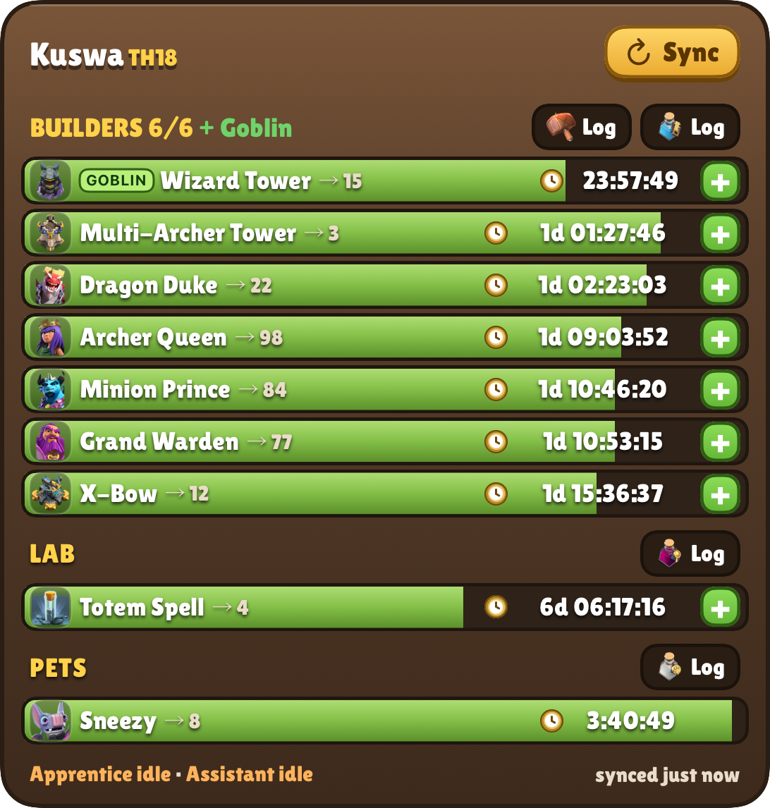
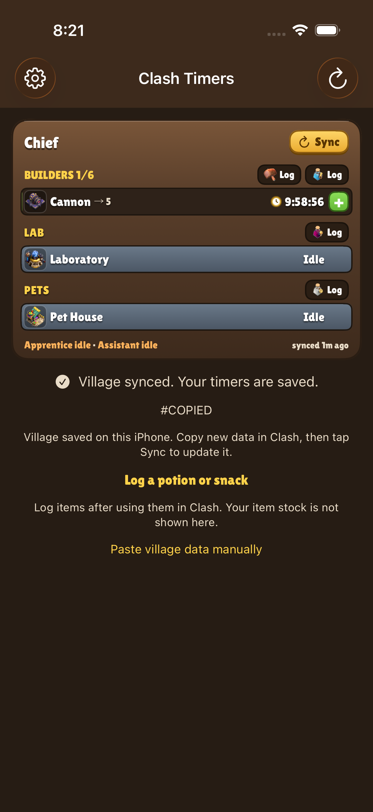

# Clash Timers for iOS

**An unofficial iPhone and iPad port of [Clash Timers by Kuswaa (Kuswa Tul Kaabah)](https://github.com/Kuswaa/clash-timers).** Credit for the original Android app, widget design and timer logic belongs to the original author. This repository maintains the iOS adaptation independently; it is not an official release from Kuswaa or Supercell.

Track your home-village builders, laboratory research and pets from an iPhone Home Screen widget. The app uses SwiftUI and WidgetKit, reuses the original project's game assets and font under their respective terms, and calculates timers offline from the village export you copy in Clash of Clans.

## Download and install

**Current release: [v1.0.5 — Online level refresh](https://github.com/Julianyin1234567890/clash-timers-ios/releases/tag/ios-v1.0.5).** Download **ClashTimers-AltStore.ipa** from the release assets.

- [Detailed Word installation guide](https://github.com/Julianyin1234567890/clash-timers-ios/releases/latest/download/Clash-Timers-AltStore-Guide.docx)
- [Detailed PDF installation guide](https://github.com/Julianyin1234567890/clash-timers-ios/releases/latest/download/Clash-Timers-AltStore-Guide.pdf)
- [Installation and build instructions](ios/README.md)

Requires **iOS/iPadOS 17 or newer**. Install through **AltStore Classic** and choose **Keep App Extensions** to include the widget. Windows users can install with AltServer; a Mac is not required for this route. With a free Apple account, renew the app through AltStore before its seven-day signature expires. This app is not distributed through the App Store.

## What it looks like

  
  

Actual simulator captures with example village data. Small and medium widgets show fewer rows to fit Apple's widget sizes.

## Download levels without copying an export

1. Tap **Refresh levels online** in Clash Timers.
2. Enter your public **player tag** once (the `#…` on your Clash profile), then tap **Download & sync levels**.
3. View reported hero, troop, spell, siege machine, pet and owned hero-equipment levels. The next check highlights increases compared with the previous successful check.
4. Optionally enable **Refresh when I open the app**. After at least five minutes, reopening the app checks again. It does not poll continuously while closed.

This optional feature uses the public [Clash of Stats](https://www.clashofstats.com) player lookup from your iPhone. No API key, Supercell login, PC relay or repeated JSON export is needed. The provider may return cached data. The displayed time is the time of the successful request, not a guarantee of the data's age. Building levels, active upgrade countdowns, and potion/snack inventory are not supplied by this lookup.

Your saved online profile survives relaunches and failed requests. It is kept separate from the timer export, so refreshing levels never changes your widget countdowns. If you choose a different player tag, the online profile switches only after a successful download. Remove it from the levels screen to stop automatic refresh and delete the local profile.

## Copy in Clash, then Sync countdowns

1. In Clash of Clans, open **Settings → More Settings → Data Export → Copy**.
2. Tap **Sync** on the medium or large widget. On the small widget, tap anywhere. You can also tap Sync inside the app.
3. Clash Timers opens and saves the copied village immediately. Choose **Allow Paste** if iOS asks, then swipe Home to return to the widget.

There is no separate Paste or Import confirmation on this path. Saved countdowns keep running between syncs. **Copy fresh data after starting new upgrades or changing their finish times in the game.** Countdowns use an offline snapshot; online level refresh does not discover newly started building upgrades.

## Features and practical limits

- Small, medium and large Home Screen widgets for builder, laboratory and pet timers.
- Potion and Builder Bite logging, undo controls, and helper links. **Log** records an item you used in Clash; it does not show your owned inventory.
- Local finish notifications. Tapping a notification opens Clash Timers.
- Offline timer snapshots plus optional online level refresh. No account, ads or analytics. Clipboard reads happen only after a Sync or paste action.
- Helper predictions assume you activate future helper sessions. A fresh export corrects the saved snapshot.
- iOS controls widget redraw timing. Sync opens the app; it does not silently close back to the Home Screen as the original Android activity does.

## Privacy and online service

Timer exports stay on your device (and may be included in your personal iOS backup). Choosing online refresh sends the requested public player tag to `api.clashofstats.com` over HTTPS; that service also sees normal connection information such as your IP address. No village export, Supercell credentials or Apple credentials are sent. Requests begin only after you choose Download, or on app opening if you enabled that option. The widget does not make network requests. This is an independent integration with a third-party public service, not an official API partnership; availability and response formats may change.

[Build and test results](https://github.com/Julianyin1234567890/clash-timers-ios/actions/workflows/ios.yml).

## Original project and credits

- **Original author:** [Kuswaa / Kuswa Tul Kaabah](https://github.com/Kuswaa). [Original Clash Timers repository](https://github.com/Kuswaa/clash-timers).
- **Android version:** get its releases and updates from the original repository. The [Android documentation](docs/ANDROID.md) is retained here for reference.
- **Game artwork, names and data:** Supercell, with data/assets sourced by the original project from [clash-of-clans-data](https://github.com/chiefpansancolt/clash-of-clans-data), credited to Christopher Pezza.
- **Online player levels:** [Clash of Stats](https://www.clashofstats.com). Provider-specific IDs are mapped separately from game-export IDs. See [mapping provenance](docs/ONLINE-LEVELS.md).
- **Font:** Lilita One by Juan Montoreano, under the SIL Open Font License.

The original copyright and [MIT code license](LICENSE) are retained. Game assets and the font have separate terms; see [NOTICE](NOTICE) and the [iOS resource notices](ios/Sources/ClashTimersCore/Resources/NOTICE). The iOS port was developed with AI assistance.

For iOS bugs or contributions, [open an issue in this repository](https://github.com/Julianyin1234567890/clash-timers-ios/issues). Include your iOS version, app version and steps to reproduce the problem.

## Disclaimer

This material is unofficial and is not endorsed by Supercell. For more information see [Supercell's Fan Content Policy](https://supercell.com/en/fan-content-policy/). Clash of Clans names, artwork and game assets belong to Supercell.
